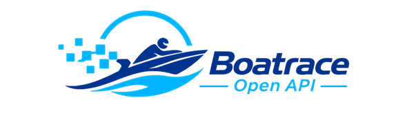

<p align="center">
    <a href="https://github.com/boatraceopenapi/api">
        
    </a>
</p>

[](https://github.com/boatraceopenapi/api/tree/gh-pages/docs/v1)
[](https://opensource.org/licenses/MIT)

[](https://github.com/boatraceopenapi/api/actions/workflows/deploy-pages.yml)
[](https://github.com/boatraceopenapi/api/actions/workflows/test.yml)
[](https://github.com/boatraceopenapi/api/actions/workflows/psalm.yml)
[](https://github.com/boatraceopenapi/api/actions/workflows/audit.yml)
[](https://github.com/boatraceopenapi/api/actions/workflows/sync.yml)
[](https://github.com/boatraceopenapi/api/actions/workflows/sync-upcoming.yml)
[](https://github.com/boatraceopenapi/api/actions/workflows/keepalive.yml)
[](https://github.com/boatraceopenapi/api/actions/workflows/dependabot/dependabot-updates)

---

## ⚠️ 注意事項

**本 API を利用する前に、以下の内容をご確認ください。**

- **非公式です。** BOAT RACE 公式サイトおよび関連団体とは一切関係ありません。
- **リアルタイムではありません。** GitHub Actions による約 10 分間隔の定期更新のため、最新情報の反映まで 10〜20 分程度の遅れが生じる場合があります。
- **正確性・完全性は保証していません。** 収集・変換の都合により、欠損や誤りが含まれる可能性があります。
- **公式な情報が必要な場合は、必ず BOAT RACE 公式サイトをご確認ください。**
- **利用は自己責任でお願いします。**

---

## 📝 概要

本 API では、ボートレース（競艇）のデータを取得できます。データは GitHub Pages 上で公開されており、JSON 形式で提供されます。

| 項目 | 内容 |
|---|---|
| 対応レース場 | 全国 24 場すべて（1 日分のデータに全場の情報を含む） |
| 取得可能なデータ | 出走表・直前情報・結果 |
| 更新 | 当日分を約 10 分間隔で更新 |

---

## 🌐 エンドポイント

対応期間: **2026年01月01日以降**

```bash
https://boatraceopenapi.github.io/api/v1/YYYY/YYYYMMDD.json
```

- `YYYY` → 年
- `YYYYMMDD` → 年月日
- 日付は日本標準時（JST / UTC+9）基準

> データが存在しない日付（対応期間外・未来日付など）を指定した場合、GitHub Pages の仕様により HTTP 404 が返されます。

---

## 📦 レスポンス仕様

レスポンスの JSON 構造・各フィールドの詳細については、スキーマドキュメントを参照してください。

→ [docs/v1/schema.md](docs/v1/schema.md)

`stadium_number`（レース場）や `place_number`（着順）などのコード値の意味は、コード表を参照してください。

→ [docs/v1/codes.md](docs/v1/codes.md)

---

## 💡 サンプル

- 2026年05月01日のデータ: [https://boatraceopenapi.github.io/api/v1/2026/20260501.json](https://boatraceopenapi.github.io/api/v1/2026/20260501.json)
- 本日のデータ: [https://boatraceopenapi.github.io/api/v1/today.json](https://boatraceopenapi.github.io/api/v1/today.json)

各言語でのデータ取得・パース例は [docs/v1/example.md](docs/v1/example.md) を参照してください。

---

## 🤖 AI エージェントで利用する場合

Claude Code や Codex などの AI エージェントにデータの取り込みや分析を任せる場合は、次の URL を読ませてください。取得方法・コード値の扱い・集計の注意点を AI 向けにまとめています。

```
https://boatraceopenapi.github.io/api/llms.txt
```

---

## 🤝 コントリビューション

**Pull Request は受け付けておりません。**

- バグ報告・不具合の指摘・機能要望・改善提案 → [Issues](../../issues) からお願いします。
- 個人開発のため、レビュー・メンテナンスのリソースが限られています。いただいた Issue は内容を確認の上、こちらで対応・実装を判断させていただきます。

---

## 📄 ライセンス

Boatrace Open API のソースコードは [MIT license](LICENSE) の下で公開されています。

API で配信しているデータは BOAT RACE 公式サイトの公開情報を基にしており、MIT license の対象ではありません。データの権利は本プロジェクトにはないため、データの利用条件（商用利用を含む）についてお答えすることはできません。利用の可否は元データの権利者にご確認ください。
